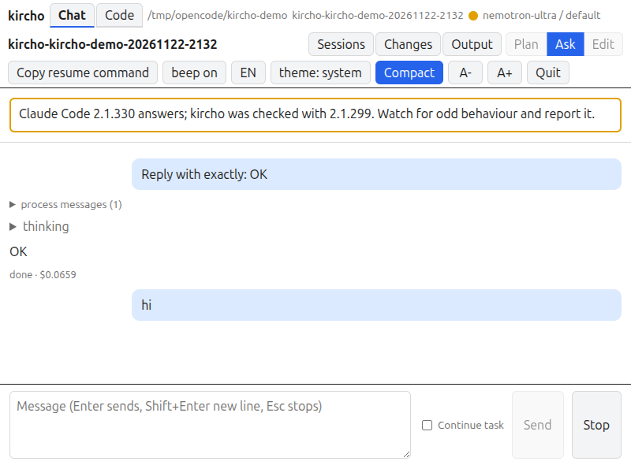

# ai_runtime — LLM runtime for LiteLLM and kiko

[Bulgarian version: README.bg.md](README.bg.md)

> In short: free keys from NVIDIA and Google → `kiko install` → `./run-claude-kiko.sh`.
> No fee, no `npm`, no sudo, no `config.yaml` with keys in it.

There are two ways to run a local gateway and drive it from the desktop here:

| | Gateway | Tray / panel | Verified on |
|---|---|---|---|
| **kiko** (lighter, recommended) | stdlib only, `127.0.0.1:4000` | GTK3 on Linux Mint | Mint 22.3 |
| **LiteLLM** (old, still works) | Python wheel + `~/.litellm/config.yaml` | TDE panel on Q4OS | Q4OS 6 / TDE R14 |

The documentation below follows the kiko path: Claude Code speaks the Anthropic API
directly to kiko through `run-claude-kiko.sh`. The old LiteLLM launcher
(`run-claude.sh`) was replaced by it; the TDE applet sources are still in `src/`
(see the last section).

## Why kiko, not LiteLLM

| | LiteLLM (old) | kiko (now) |
|---|---|---|
| Dependencies | wheel with FastAPI, uvicorn, pydantic, httpx… | Python stdlib only |
| Configuration | `~/.litellm/config.yaml` with keys in the file | keys in the OS keyring, 13 verified aliases in SQLite |
| API | OpenAI-compatible proxy | Anthropic `/v1/messages` (Claude Code works directly) |
| Installation | `pipx`/`pip`, systemd service | `kiko install`, no sudo |
| Cost | Depends on the upstream provider | the same free tiers of NVIDIA and Google — **no software fee** |

Free does not mean unlimited: the free tiers have rate limits. The verified aliases
below return 200 through kiko; the keys take minutes to get and need no card.

## 1. Get free API keys

| Key | Where | Used for |
|---|---|---|
| `NVIDIA_API_KEY` | https://build.nvidia.com/ → sign in → API Keys | `nemotron-ultra`, `nemotron-super`, `llama-nemotron`, `muse-glimmer` |
| `GEMINI_API_KEY` | https://aistudio.google.com/apikey → Create API key | `gemini-lite`, `gemini-tutor` |

Optional: `MISTRAL_API_KEY` (https://console.mistral.ai/api-keys),
`OPENROUTER_API_KEY` (https://openrouter.ai/keys), `GROQ_API_KEY` (https://console.groq.com/keys).
`GITHUB_TOKEN` is only needed for pushing to GitHub. If a key was ever pasted into a
chat or committed, revoke it and get a new one. Never put a value in a file.

## 2. Install kiko

```bash
sudo apt install -y libsecret-tools curl
git clone https://github.com/peterkokosharov/kiko.git ~/kiko
cd ~/kiko && bash tray/tools/kiko install
kiko doctor
curl -sS http://127.0.0.1:4000/health
# {"status":"ok"}
```

`kiko install` asks for the keys with echo off, puts the 13 verified aliases in
`~/.kiko/kiko.db`, creates the systemd **user** unit `kiko-proxy.service` and starts
the gateway. No sudo for the install itself.

The `.deb` variant (easier for colleagues):

```bash
cd ~/kiko
bash packaging/build-deb.sh
sudo apt install -y ./dist/kiko_0.3.0_all.deb
kiko install
```

Mint/Ubuntu also have a separate GTK3 tray package:

```bash
sudo apt install -y build-essential cmake libgtk-3-dev fakeroot
cd ~/kiko && bash packaging/build-tray-gtk3-deb.sh
sudo apt install -y ./dist/kiko-tray-gtk3_0.1.0_amd64.deb
```

The full guide, including Q4OS and uninstall, is in `~/kiko/docs/INSTALL.md`.

## 3. Install Claude Code

```bash
curl -fsSL https://claude.ai/install.sh | bash
echo 'export PATH="$HOME/.local/bin:$PATH"' >> ~/.bashrc
source ~/.bashrc
claude --version          # 2.1.330 here
```

The native installer puts `claude` in `~/.local/bin`; it needs neither root nor
Node/npm.

## 4. Run Claude through kiko

```bash
git clone https://github.com/peterkokosharov/ai_runtime.git ~/ai_runtime
cd ~/ai_runtime
./run-claude-kiko.sh -p 'Reply with exactly: OK'   # → OK
./run-claude-kiko.sh                               # interactive session
```

`run-claude-kiko.sh` sets `ANTHROPIC_BASE_URL=http://127.0.0.1:4000`, a dummy token
and the aliases from kiko's database. It checks `/health` before starting Claude and
falls back to `~/.local/bin/claude` if `PATH` was not re-read.

### Which name is which model

| Env var | kiko alias | Role |
|---|---|---|
| `ANTHROPIC_MODEL` | `nemotron-ultra` | main model |
| `ANTHROPIC_DEFAULT_OPUS_MODEL` | `nemotron-ultra` | manager / review |
| `ANTHROPIC_DEFAULT_SONNET_MODEL` | `llama-nemotron` | main development (cleanest answer in the comparison, 0.9 s) |
| `ANTHROPIC_DEFAULT_FABLE_MODEL` | `muse-glimmer` | external audit |
| `ANTHROPIC_DEFAULT_HAIKU_MODEL` | `gemini-lite` | fast simple tasks |

Do not use LiteLLM-style names such as `nvidia/nemotron-ultra` — kiko treats them as
upstream ids and returns 404. Use the local aliases from the database.

### Where the keys live

* In GNOME Keyring: `service=/peterk`, `key=<KEY>`, `username=<your login>`, label `/peterk/<KEY>`.
* `ANTHROPIC_AUTH_TOKEN=sk-dummy-key` is only a filler — Claude requires the variable, kiko ignores it.
* The kiko management API token stays in `~/.kiko/api-token` with mode `0600`.
* No value goes into git, `.env` or a shell profile.

### Which variables matter

* `CLAUDE_CODE_DISABLE_UNKNOWN_MODEL_WINDOW_ENFORCEMENT=1` — **kept**. The aliases are unknown
  to Claude Code, so it cannot know their context window; the flag makes it compact after a real
  API "too long" instead of a presumed limit.
* `LITELLM_DROP_PARAMS` — **removed**. LiteLLM-specific; kiko never reads it.
* `DISABLE_PROMPT_CACHING` — **removed**. kiko builds the request from a whitelist and drops
  `cache_control` before the upstream call, so there is nothing to disable.

Details and the checks from 2026-11-22 are in [`KIKO.md`](KIKO.md).

## 5. Desktop window on Linux Mint (kircho)



[`kircho`](https://github.com/peterkokosharov/kircho) is a small local web UI for one
Claude Code session in one folder. It is a separate repo, not part of this one. It
needs Python 3.12+, `git` and `claude` on `PATH`; no build step, no Docker, no extra
packages. Checked on Linux Mint 22.3.

**This is where this repo comes in.** Kircho passes the environment it was started
with to the Claude child. Export the variables from `run-claude-kiko.sh` in the shell
that starts kircho — `--env` and a profile's `env` deliberately refuse
`ANTHROPIC_*`/`CLAUDE_*`, so they cannot set the endpoint. With this environment
there is no Claude `/login`: the request goes to kiko, which adds the real key from
the keyring.

```bash
# kiko must already answer: curl -sS http://127.0.0.1:4000/health
cd ~/ai_runtime
eval "$(grep '^export ' run-claude-kiko.sh)"   # the same env, without `exec claude`
export PATH="$HOME/.local/bin:$PATH"

git clone https://github.com/peterkokosharov/kircho.git ~/kircho
cd ~/kircho
python3 -m kircho --folder ~/projects/demo --model nemotron-ultra \
    --window default --mode ask --port 4747
```

The console prints `http://127.0.0.1:4747/kircho/#c=<one-time code>`; open it in a
browser. The code works once, for two minutes, and is exchanged for a token kept in
the page and an HttpOnly cookie. `--window none` only prints the link;
`--window firefox` forces that browser. The server binds `127.0.0.1` only. The
header switches Plan / Ask / Edit while Claude is idle; Ask shows an Allow/Deny card
for every edit and shell command. Stop with **Quit** or
`python3 -m kircho stop --port 4747`.

Do **not** `source run-claude-kiko.sh` — it ends with `exec claude`. The `eval` above
takes only its `export` lines. Copying those exports by hand is equally fine; the
values are the model-alias table and the key rules from section 4.

## Useful commands

```bash
KIKO_PORT=5000 kiko install    # a second gateway on another port
kiko models                    # reload aliases without wiping the database
kiko restart                   # restart the user service
kiko uninstall                 # remove service and code; keep the database and keys
kiko uninstall --purge         # also the database; keys still remain
```

If `[claude-code:unrecognized_model] ...` appears, that is a local Claude Code
warning about an unknown model id, not a gateway error. The answer still comes
through kiko.

## The old TDE/LiteLLM applet (legacy)

`src/litellm_applet.*`, `src/litellm_process.*`, `litellm.service`,
`config-sample.yaml`, `install-service.sh` and `debian/` are from the original
**Q4OS 6 / TDE R14** project. They drive LiteLLM through `~/.litellm/config.yaml`
and are not used in the flow described here. They are kept for reference only —
kiko is lighter and keeps no keys in a file. If you need a TDE panel, kiko ships
its own `tray/tqt3/` (for Q4OS), but it was not built on this machine.

## Files in this repo

| File | What it does |
|---|---|
| `README.md` | this document (English) |
| `README.bg.md` | Bulgarian version |
| `run-claude-kiko.sh` | the only launcher — Claude Code → kiko |
| `KIKO.md` | model mapping, checks, explanation of the env variables |
| `docs/kircho-mint.png` | screenshot of kircho on Mint with the kiko aliases |
| `kiko-proxy.service`, `install-kiko-service.sh` | older checkout-based way to install the same service; `kiko install` is canonical |
| `src/`, `litellm.service`, `debian/` | legacy TDE applet for LiteLLM |

## License

MIT — Copyright Peter Kokosharov <peter.kokosharov@gmail.com>
